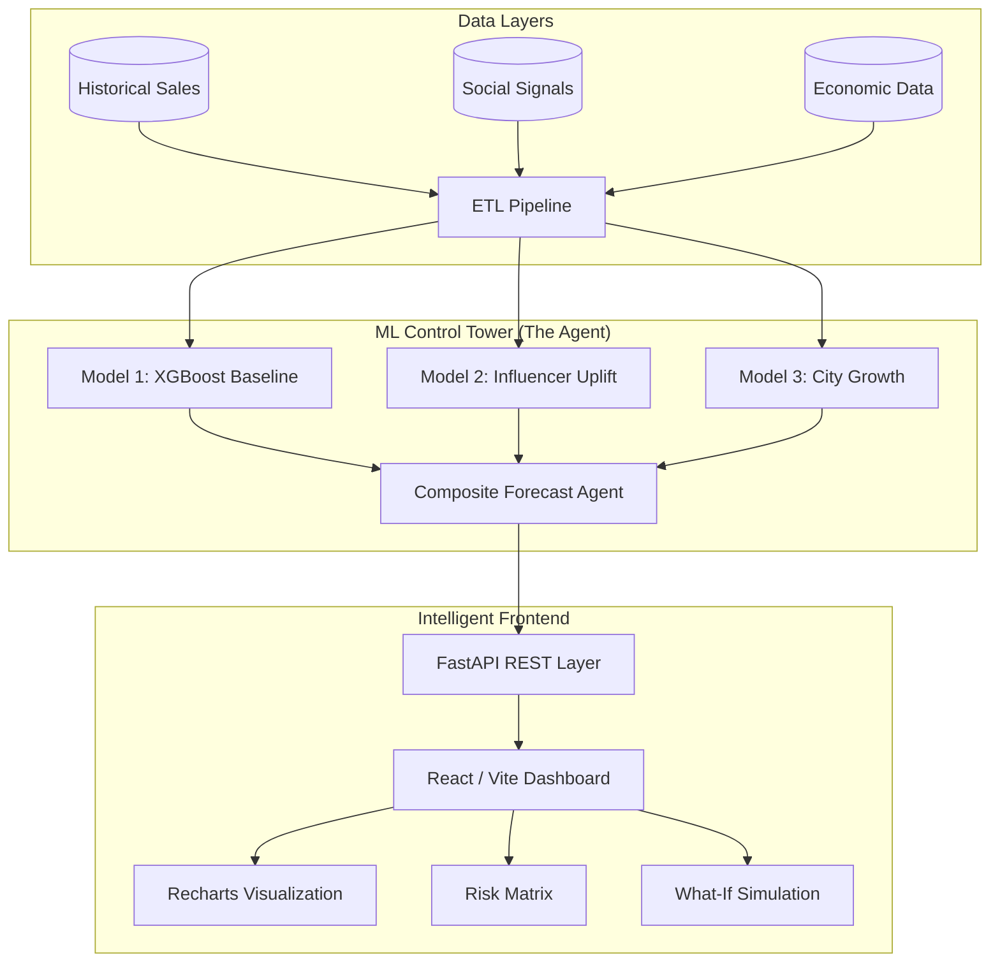

# 🚀 Control Tower: AI-Driven Supply Chain Intelligence

[](https://github.com/studentanush/Cummins_Hackathon)
[](https://github.com/studentanush/Cummins_Hackathon)

**Control Tower** is a state-of-the-art supply chain analytics platform designed for the modern retail landscape. By fusing traditional baseline demand with real-time influencer signals and city-level economic growth indicators, it provides a high-fidelity "Control Tower" view of inventory risks and demand surges.

---

## 💎 The Problem & Our Solution

Traditional supply chain models often fail to capture **short-term volatility** (influencer surges) and **localized economic shifts** (city-level growth). 

**Our Innovation:** A modular **3-Model Pipeline** that aggregates:
1.  **Macro Baseline**: Long-term seasonality and trend (XGBoost).
2.  **Influencer Pulse**: Hyper-local demand spikes triggered by social media marketing (Multi-target Regressors).
3.  **City Dynamics**: External economic indicators like income velocity and housing affordability (LightGBM).

---

## 🏗️ Technical Architecture



---

## 🚀 Getting Started

### 1. Prerequisites
- **Python 3.10+**
- **Node.js 18+**
- **Modern Browser** (Chrome/Edge recommended)

### 2. Environment Setup
```bash
# Clone the repository
git clone https://github.com/studentanush/Cummins_Hackathon.git
cd Cummins_Hackathon

# Initialize data and train models
python scripts/conti_script.py
python scripts/model1_script.py
python scripts/seed_and_train_influencer_demo.py
python scripts/build_case_study_tables.py
```

### 3. Launch Services
**Backend (FastAPI):**
```bash
cd backend
python -m venv .venv
# Windows: .venv\Scripts\activate | Linux: source .venv/bin/activate
pip install -r requirements.txt
python -m uvicorn app.main:app --reload
```

The API serves from a database built from the CSVs in `analytics/` and `data/`. Production deployments use Supabase PostgreSQL through `DATABASE_URL`; local development falls back to SQLite at `backend/var/optichain.sqlite3` when `DATABASE_URL` is unset. The database is created automatically on first start and reloaded whenever a source CSV changes. To rebuild it by hand (validates and verifies every row before committing), or to point at another database with `DATABASE_URL`:
```bash
python -m app.db.ingest --force
```

For Supabase, set `DATABASE_URL` to the project PostgreSQL connection string
before starting the backend. Use the pooled connection string when the hosting
platform creates many short-lived connections. Production deployment sets
`DATABASE_REQUIRE_POSTGRES=true`, so it fails explicitly instead of silently
falling back to SQLite when the Supabase URL is missing.

Tests and benchmark:
```bash
pip install -r requirements-dev.txt
python -m pytest tests
python scripts/benchmark.py --out bench.json
```

**Frontend (React + Vite):**
```bash
cd frontend
npm install
npm run dev
```


## 🛠️ Feature Showcase

### 🔮 High-Fidelity Forecasting Agent
Combines the 3-model pipeline to predict daily demand with granular precision. Includes a **decay-aware lift curve** for influencer campaigns, allowing buyers to see exactly how demand will taper over 96 hours.

### ⚠️ Unified Risk Register
A proactive inventory monitor that flags SKUs for **Stockout** or **Overstock** based on lead-time demand volatility and current inventory levels.

### 🧪 Model-Driven What-If Simulations
Simulate real-world scenarios (e.g., "What if this influencer campaign reaches 1M followers?") and see the immediate impact on inventory drawdown over a 14-day horizon.

---

## 📂 Project Structure

| Directory | Description |
| :--- | :--- |
| `backend/app/api/` | Route modules, grouped by domain. |
| `backend/app/core/` | Logging, middleware, and the loaded-model registry. |
| `backend/app/services/` | ML inference, risk engine, and brief generation. |
| `frontend/src/components/` | Design-system primitives, layout, and chart shells. |
| `frontend/src/features/` | Dashboard and forecast feature components. |
| `frontend/src/pages/` | Route-level pages (lazy-loaded). |
| `notebooks/` | Research & development Jupyter notebooks for ML models. |
| `scripts/` | Data engineering, seeding, and model training utilities. |
| `models/` | Serialized model artifacts (.pkl). |
| `data/` | Raw and engineered datasets (CSV). |

See [`frontend/README.md`](frontend/README.md) for the design system, theming
and accessibility conventions.

---

## 🧱 Engineering Notes

**Frontend** — React 19 + TypeScript (strict) + Vite + Tailwind. A single token
layer drives light, dark and system themes across every surface, including
charts. Pages are code-split; vendors are chunked separately for cache
stability. Linting covers TypeScript, React Hooks and `jsx-a11y`.

**Backend** — FastAPI with structured logging, per-request correlation ids
(`X-Request-ID`), security headers, gzip, and validated environment settings.
Model artifacts load once at startup into a typed registry; anything missing is
reported through `/api/health` rather than failing the service.

**API documentation** — interactive docs are served at `/docs` (Swagger UI) and
`/redoc` once the backend is running.

> **CORS note:** `CORS_ORIGINS` defaults to `*`, which disables credentialed
> cross-origin requests (browsers reject a wildcard origin when credentials are
> sent). Set an explicit comma-separated origin list for production.

---

## 🔮 Strategic Roadmap

As we continue to scale the Control Tower platform for enterprise supply chains, our immediate focus areas include:

- [ ] **Generative AI Orchestration**: Integrating advanced LLMs to replace rule-based heuristics with narrative, actionable insights on demand drivers and risk mitigation.
- [ ] **Enterprise MLOps**: Migrating the 3-model training pipeline to a managed cloud environment for automated retraining and endpoint deployment.
- [ ] **Embedded Business Intelligence**: Integrating deep, interactive BI dashboards for executive-level reporting and cross-functional visibility.
- [ ] **Cloud-Native Data Warehousing**: Transitioning from flat-file storage to a highly scalable, columnar data warehouse to support real-time analytics across millions of SKUs.

---
*Built for the future of intelligent supply chain management.*
